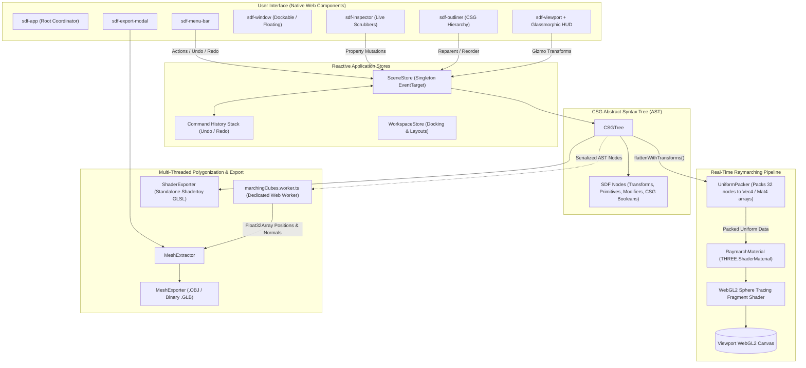

# ⚡ SDF Studio 3D

> **High-Performance Implicit 3D Modeler Powered by WebGL2 Raymarching & Native Web Components.**  
> Create complex mathematical 3D solids using Constructive Solid Geometry (CSG), smooth polynomial blending, and multi-threaded Marching Cubes polygonization directly in the browser with **zero heavy frontend frameworks**.

---

[](https://vitejs.dev/)
[](https://www.typescriptlang.org/)
[](https://threejs.org/)
[](https://developer.mozilla.org/en-US/docs/Web/API/Web_components)
[](https://www.khronos.org/webgl/)
[](https://vitest.dev/)
[](LICENSE)

---

## 🌟 What Makes SDF Studio 3D Unique?

Traditional 3D modeling tools rely on boundary representation (B-Rep) or polygonal meshes, which require manual topology cleanup, UV unwrapping, and complex boolean mesh slicing that often produces non-manifold geometry. 

**SDF Studio 3D** models shapes as **Signed Distance Fields (SDFs)**—pure mathematical functions that compute the exact distance from any point in space to the surface:

1. **Framework-Free Native Web Components Architecture**: Built from the ground up using W3C Custom Elements and CSS custom properties. Zero React, Vue, Angular, or external UI component libraries—offering microsecond DOM updates and instant startup.
2. **Real-Time WebGL2 Sphere Tracing**: Evaluates up to 32 hierarchical CSG operations per frame on a full-viewport screen-space quad, achieving stable 60 FPS lookdev rendering.
3. **Smooth Polynomial CSG Booleans**: Organic blending between hard mechanical shapes and flowing forms without seams, pinched vertices, or normal artifacts.
4. **Non-Blocking Marching Cubes Web Worker**: When you are ready to export, a dedicated multi-threaded Web Worker polygonizes the implicit field into watertight triangle meshes at 32³, 64³, or 128³ grid resolutions.
5. **Zero-Dependency Native File Exporters**: Generates compliant Wavefront `.obj` files and binary glTF 2.0 (`.glb`) containers directly from raw binary buffers in memory without third-party converter bloat.

---

## 🚀 Features Showcase

### 1. 21 Exact & Bound SDF Primitives
SDF Studio 3D provides a comprehensive library of geometric primitives, from standard CAD primitives to higher-order fractals:

| Category | Primitives |
| :--- | :--- |
| **Basic Curvature** | Sphere, Cylinder, Capsule, Cone, Hemisphere, Ellipsoid, Torus |
| **Polyhedra & Prisms** | Box, Pyramid, Pentagonal Pyramid, Wedge, Frustum, Triangular Prism, Pentagonal Prism, Hexagonal Prism, Tetrahedron, Octahedron |
| **Mechanical & Architectural** | Hollow Pipe / Tube, Infinite Ground Plane |
| **Higher-Order & Fractals** | Superellipsoid, Mandelbulb 3D Fractal (Iterative power-8 trigonometric raymarching) |

### 2. Smooth CSG Booleans
Combine primitives seamlessly with real-time boolean operations:
- **Union ($\cup$)**: Merges shapes into a single continuous volume.
- **Difference ($\setminus$)**: Cuts and carves child shapes out of parent volumes (ideal for drill holes, vents, slots).
- **Intersection ($\cap$)**: Isolates the overlapping volume of intersecting shapes.
- **Polynomial Smooth Minimum ($smin$)**: Uses Inigo Quilez polynomial smoothing ($k \in [0.0, 1.0]$) to organically melt transitions between primitives:
  $$smin(a, b, k) = \text{mix}(b, a, h) - k \cdot h \cdot (1.0 - h), \quad h = \text{clamp}\left(0.5 + 0.5 \cdot \frac{b - a}{k}, 0.0, 1.0\right)$$

### 3. Spatial Non-Linear Modifiers
Apply real-time spatial transformations before distance evaluation:
- **Twist Deformation**: Rotates space along the vertical axis ($y$) based on an adjustable twist factor.
- **Shell / Hollow**: Hollows out solids into thin-walled shells with customizable interior thickness.
- **Corner Rounding**: Offsets the isosurface outwards to round sharp hard edges.
- **Symmetry / Mirror**: Reflects coordinate space across the $X$, $Y$, or $Z$ plane for symmetrical modeling.

### 4. Blender 4-Inspired DCC Interface
Crafted with the ergonomics of modern Digital Content Creation (DCC) suites:
- **Slate & Charcoal Studio Palette**: Blender 4 orange accents (`#ea7600`), 1px subtle borders, and dual-theme Dark/Light modes.
- **Dockable & Floating Windows**: Freely drag, resize, dock to Left/Right viewport edges, or park panels in a glassmorphic bottom shelf tray.
- **Lookdev Glassmorphic Viewport HUD**: Quick-access controls for instant matcap switching, shadow toggling, ambient occlusion, and camera orientation.
- **Hierarchical Outliner**: Full tree view of primitives and CSG groups with visibility toggles, tree reordering, and item deletion.
- **Interactive 3D Transform Gizmo**: Integrated Three.js `TransformControls` for direct viewport manipulation (Translate, Rotate, Scale).

### 5. Lookdev Shading Modes & Visual Effects
- **5 Real-Time MatCaps**:
  - 🏺 **Dark Clay**: Clean matte sculpting clay for inspecting silhouette and form.
  - 🕯️ **Red Wax**: Classic ZBrush-style wax matcap for surface contour inspection.
  - 🌈 **Normal Map**: World-space surface normal coloration ($\vec{N} \cdot 0.5 + 0.5$).
  - 🪞 **Chrome Mirror**: High-reflectivity metallic environment lookdev.
  - 🌅 **Sunset Horizon**: High-contrast atmospheric rim lighting.
- **Raymarched Soft Shadows**: Dynamic penumbra soft shadows computed through secondary raymarching towards light sources.
- **Volumetric Ambient Occlusion (AO)**: Screen-space multi-sample normal offsets providing realistic contact shadowing in crevices and cavities.

### 6. Multi-Threaded Marching Cubes Polygonizer
Extract triangle meshes from implicit mathematical fields without freezing the user interface:
- **Web Worker Execution**: CPU Marching Cubes algorithm executed in `marchingCubes.worker.ts`.
- **Configurable Resolutions**:
  - `32³` (Preview): Instant low-poly blockouts.
  - `64³` (Standard): Smooth geometric fidelity for standard assets.
  - `128³` (High-Fidelity): Dense, detail-preserving mesh extraction.
- **Real-Time Progress Tracking**: Step-by-step progress bars and vertex/face count diagnostics.

### 7. Universal Export Pipelines
- **Wavefront `.obj`**: Standard text format with geometric vertices (`v`), normals (`vn`), and 1-indexed triangular faces (`f`).
- **Binary glTF 2.0 (`.glb`)**: Fully compliant Khronos glTF 2.0 binary package with embedded PBR metallic-roughness material channels and calculated bounding boxes.
- **Standalone Shadertoy GLSL**: Generates self-contained, copy-pasteable GLSL fragment code with camera orbits and analytic distance functions ready to run on [shadertoy.com](https://www.shadertoy.com).
- **Native `.sdf.json` Project Document**: JSON-serialized CSG Abstract Syntax Tree (AST) preserving hierarchy, transforms, modifiers, and material configurations.

---

## ⌨️ Viewport Navigation & Keyboard Shortcuts

| Shortcut | Action | Description |
| :--- | :--- | :--- |
| **Left Click + Drag** | Orbit Camera | Rotates view around the current target center |
| **Right Click + Drag** / **Shift + Middle Click** | Pan Camera | Panning across the viewport plane |
| **Mouse Wheel** | Zoom In / Out | Adjusts camera distance from scene origin |
| **NumPad 1** / **1** | Front View | Snaps camera to Orthographic/Front orientation |
| **NumPad 3** / **3** | Right View | Snaps camera to Right side profile |
| **NumPad 7** / **7** | Top View | Snaps camera to Top-down elevation |
| **F** | Focus / Frame | Frames camera view onto the currently selected object |
| **Ctrl + Z** / **Cmd + Z** | Undo | Rolls back the last scene modification (50 steps) |
| **Ctrl + Y** / **Cmd + Shift + Z** | Redo | Replays previously undone scene commands |
| **Ctrl + S** | Save Project | Saves active scene as `.sdf.json` document |
| **Ctrl + O** | Open Project | Prompts file picker to load an `.sdf.json` project |
| **Ctrl + N** | New Scene | Resets workspace to default scene configuration |

---

## 🏗️ Architecture Overview

The system bridges reactive state management with high-performance WebGL2 shader pipelines and multi-threaded CPU extraction:



---

## 📁 Directory Structure

```text
sdf-editor/
├── index.html                 # Application HTML5 shell
├── package.json               # Dependencies, scripts, and build metadata
├── tsconfig.json              # TypeScript 5.6 configuration
├── vite.config.ts             # Vite 6 bundler config with GLSL raw loading
├── src/
│   ├── main.ts                # Application bootstrapper and Web Component registry
│   ├── components/            # Pure Native Web Components (Custom Elements)
│   │   ├── SdfApp.ts          # Root workspace coordinator
│   │   ├── SdfMenuBar.ts      # Top menu bar, file actions & theme switcher
│   │   ├── SdfViewport.ts     # WebGL2 Raymarch canvas, HUD & navigation
│   │   ├── SdfWindow.ts       # Draggable, dockable floating window container
│   │   ├── SdfDockTray.ts     # Minimized window parking shelf
│   │   ├── SdfOutliner.ts     # Tree view hierarchy and CSG node management
│   │   ├── SdfInspector.ts    # Transform, dimension, modifier & material controls
│   │   ├── SdfStatusBar.ts    # Live telemetry readout (FPS, Node count, Resolution)
│   │   └── SdfExportModal.ts  # Mesh extraction (.OBJ/.GLB) & shader export dialog
│   ├── engine/                # Core raymarching and export engine
│   │   ├── RaymarchRenderer.ts# WebGL2 renderer, camera orbit & gizmo handling
│   │   ├── RaymarchMaterial.ts# Three.js ShaderMaterial definition & uniforms
│   │   ├── UniformPacker.ts   # Serializes CSG tree into compact WebGL2 uniform arrays
│   │   ├── MeshExtractor.ts   # Web Worker coordinator for Marching Cubes
│   │   ├── MeshExporter.ts    # Pure binary .GLB container and Wavefront .OBJ builder
│   │   ├── ShaderExporter.ts  # Compiles CSG AST into standalone Shadertoy GLSL
│   │   └── shaders/           # GLSL Raymarching shaders
│   │       ├── raymarch.vert.glsl # Screen-space quad vertex shader
│   │       └── raymarch.frag.glsl # Sphere tracing, soft shadows, AO & matcaps
│   ├── store/                 # State management & Command Pattern
│   │   ├── SceneStore.ts      # Reactive scene store with 50-step undo/redo stack
│   │   └── WorkspaceStore.ts  # Docking, floating, and window layout persistence
│   ├── tree/                  # CSG Abstract Syntax Tree (AST)
│   │   ├── types.ts           # SDFNode, Primitive, Modifier, and Scene schema
│   │   └── CSGTree.ts         # Hierarchical tree queries, transforms & serialization
│   ├── workers/               # Multi-threaded background tasks
│   │   ├── marchingCubes.worker.ts # Pure CPU Marching Cubes algorithm
│   │   └── marchingCubesTables.ts  # Edge lookup and triangle triangulation tables
│   └── styles/                # Modular CSS design system
│       ├── studio.css         # Base resets, viewport layout & scrollbars
│       ├── tokens.css         # Dark & Light palette variables and design tokens
│       ├── typography.css     # Inter & JetBrains Mono font configurations
│       └── animations.css     # Keyframes for window docks, fades & HUD elements
└── tests/                     # Unit & integration test suites (Vitest)
```

---

## 🛠️ Quick Start & Developer Scripts

### Prerequisites
- [Node.js](https://nodejs.org/) version **18.x** or higher
- Modern evergreen browser with **WebGL2** support (Chrome, Edge, Firefox, Brave, Safari 15+)

### 1. Installation
Clone the repository and install project dependencies:
```bash
git clone https://github.com/your-username/sdf-editor.git
cd sdf-editor
npm install
```

### 2. Development Server
Start the local Vite development server with instant Hot Module Replacement (HMR):
```bash
npm run dev
```
Open your browser at `http://localhost:3000/` to launch the 3D modeler.

### 3. Running Test Suites
Execute the automated test suite powered by Vitest:
```bash
# Run unit tests once
npm test

# Run tests in continuous watch mode
npm run test:watch
```

### 4. Type Checking
Perform strict TypeScript verification across all modules:
```bash
npm run typecheck
```

### 5. Production Build & Preview
Compile the optimized production bundle and verify locally:
```bash
# Typecheck & bundle with Vite
npm run build

# Preview production build locally
npm run preview
```

---

## 🔬 Mathematical Foundations

### Sphere Tracing (Raymarching)
Unlike traditional rasterization that processes vertices, sphere tracing marches rays from the camera position $\vec{r}_0$ along normalized view vectors $\vec{d}$:

$$\vec{p}_{n+1} = \vec{p}_n + \vec{d} \cdot f(\vec{p}_n)$$

Where $f(\vec{p})$ returns the signed distance to the closest surface. If $f(\vec{p}) < \epsilon$ (0.001), a surface intersection is registered. If the total distance traversed exceeds the far plane (100.0) or step limit (128 iterations), the ray misses into the background.

### Surface Normal Estimation
Surface normals $\vec{N}$ are analytically approximated via the gradient of the distance field using the tetrahedron forward difference method with step $\epsilon = 0.0005$:

$$\vec{N} = \text{normalize}\left(\sum_{i=1}^4 \vec{k}_i \cdot f(\vec{p} + \vec{k}_i \cdot \epsilon)\right)$$

Where $\vec{k}_1 = (1, -1, -1)$, $\vec{k}_2 = (-1, -1, 1)$, $\vec{k}_3 = (-1, 1, -1)$, and $\vec{k}_4 = (1, 1, 1)$.

---

## 📄 License

This project is licensed under the **MIT License**. See the [LICENSE](LICENSE) file for complete details.

