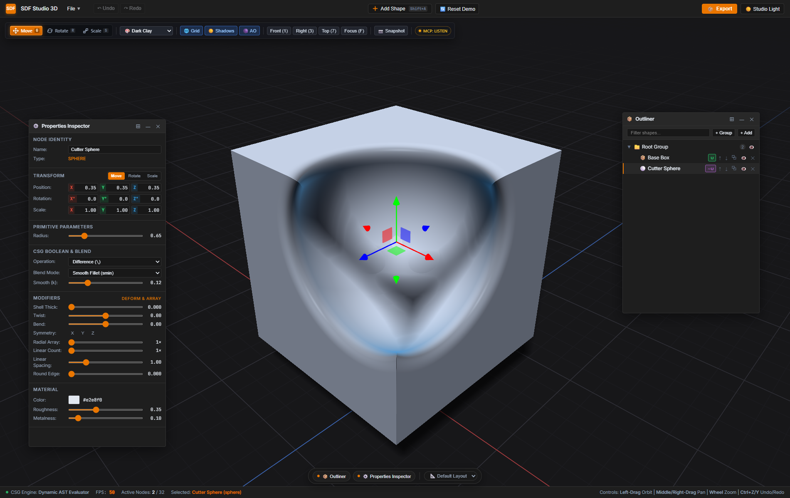
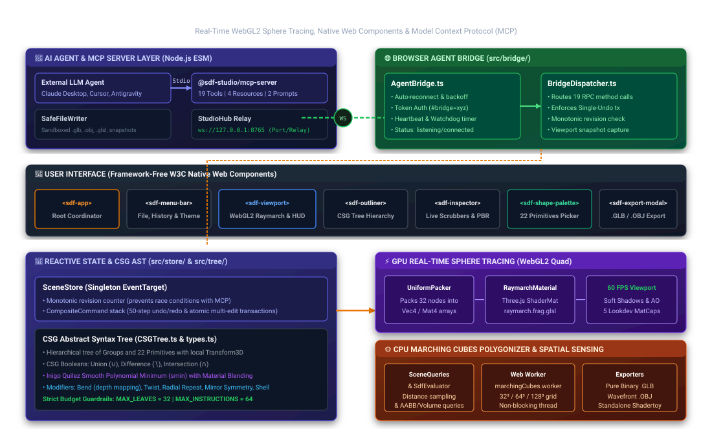
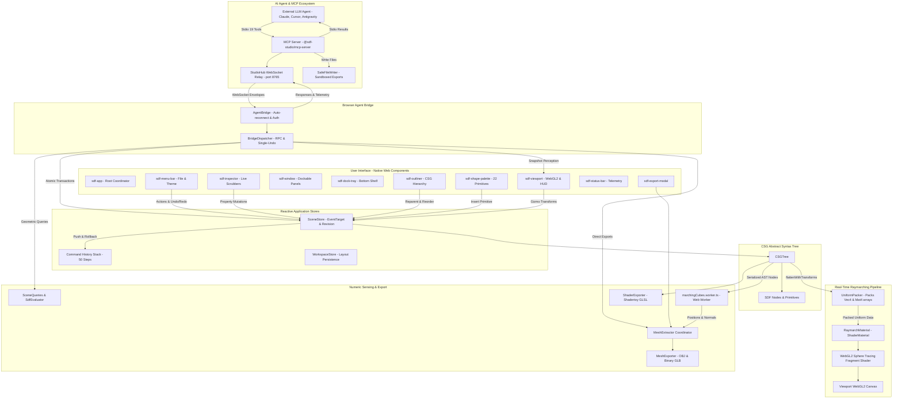

# ⚡ SDF Studio 3D

> **High-Performance Implicit 3D Modeler Powered by WebGL2 Raymarching, Native Web Components & Model Context Protocol (MCP).**  
> Create complex mathematical 3D solids using Constructive Solid Geometry (CSG), smooth polynomial blending, and multi-threaded Marching Cubes polygonization directly in the browser with **zero heavy frontend frameworks**—collaboratively driven by human artists and AI agents alike.

---

[](https://vitejs.dev/)
[](https://www.typescriptlang.org/)
[](https://modelcontextprotocol.io/)
[](https://threejs.org/)
[](https://developer.mozilla.org/en-US/docs/Web/API/Web_components)
[](https://www.khronos.org/webgl/)
[](https://vitest.dev/)
[](LICENSE)

---

<p align="center">
  
</p>

---

## 🌟 What Makes SDF Studio 3D Unique?

Traditional 3D modeling tools rely on boundary representation (B-Rep) or polygonal meshes, which require manual topology cleanup, UV unwrapping, and complex boolean mesh slicing that often produces non-manifold geometry, self-intersections, and bad normals.

**SDF Studio 3D** models shapes as **Signed Distance Fields (SDFs)**—pure mathematical functions that compute the exact distance from any point in space to the surface:

1. **Framework-Free Native Web Components Architecture**: Built from the ground up using W3C Custom Elements and CSS custom properties. Zero React, Vue, Angular, or external UI component libraries—offering microsecond DOM updates, tiny bundle overhead, and instant startup.
2. **Real-Time WebGL2 Sphere Tracing**: Evaluates up to 32 hierarchical CSG leaves on a full-viewport screen-space quad, with bounding-volume culling that skips far-away shapes and groups, on-demand rendering, and adaptive resolution while you orbit or drag (see [Viewport Performance](#8-viewport-performance)).
3. **Smooth Polynomial CSG Booleans**: Organic blending between hard mechanical shapes and flowing forms without seams, pinched vertices, or normal artifacts, complete with seamless material interpolation.
4. **AI Agent Bridge & Model Context Protocol (MCP)**: Features a dedicated stdio MCP Server and in-browser WebSocket Agent Bridge. AI models and coding agents (Claude, Cursor, Antigravity, Gemini) can programmatically inspect scene state, craft declarative CSG recipes, execute visual checks via multi-angle rendered snapshots, and export assets autonomously.
5. **Non-Blocking Marching Cubes Web Worker**: When you are ready to export, a dedicated multi-threaded Web Worker polygonizes the implicit field into watertight triangle meshes at 32³, 64³, or 128³ grid resolutions without freezing the UI.
6. **Zero-Dependency Native File Exporters**: Generates compliant Wavefront `.obj` files and binary glTF 2.0 (`.glb`) containers directly from raw binary buffers in memory without third-party converter bloat, plus standalone Shadertoy GLSL fragment shaders.

---

## 🤖 Model Context Protocol (MCP) & AI Agent Bridge

SDF Studio 3D is designed for seamless human-AI co-creation. With its built-in **Model Context Protocol (MCP)** server and live **WebSocket Agent Bridge**, external LLM agents can inspect, synthesize, critique, and export 3D models in real time while the user watches and interacts in the browser.

```
┌────────────────────────────────────────────────────────────────────────┐
│                          AI Agent / Host                               │
│              (Claude Desktop, Cursor, Antigravity, Cline)              │
└───────────────────────────────────┬────────────────────────────────────┘
                                    │ Stdio Protocol (19 Tools, 4 Resources, 2 Prompts)
                                    ▼
┌────────────────────────────────────────────────────────────────────────┐
│             SDF MCP Server (@sdf-studio/mcp-server)                    │
│                     mcp-server/src/index.ts                            │
│                                                                        │
│   • StudioHub: Local WebSocket Relay Hub (127.0.0.1:8765)              │
│   • SafeFileWriter: Sandboxed asset & snapshot exporter                │
│   • Request Queue & Concurrency Management                             │
└───────────────────────────────────┬────────────────────────────────────┘
                                    │ WebSocket RPC (ws://127.0.0.1:8765)
                                    │ Token Authentication & Heartbeats
                                    ▼
┌────────────────────────────────────────────────────────────────────────┐
│                 SDF Studio 3D In-Browser Application                   │
│                                                                        │
│   • AgentBridge (src/bridge/AgentBridge.ts) - Auto-reconnect & pairing │
│   • BridgeDispatcher (src/bridge/BridgeDispatcher.ts)                  │
│   • SceneStore - Single-undo atomic transactions & monotonic revision  │
│   • WebGL2 Sphere Tracing Renderer & Snapshot Perception Engine        │
└────────────────────────────────────────────────────────────────────────┘
```

### 1. Starting the MCP Server

Install the server's dependencies once, then build and launch it:

```bash
# One-time install (run inside the folder; `npm install --prefix mcp-server` from the root does not work)
cd mcp-server && npm install && cd ..

# Build the TypeScript MCP server (syncs shared/protocol into mcp-server/src/protocol first)
npm run mcp:build

# Launch the standalone MCP server (stdio transport)
npm run mcp:start

# Build and run the stdio + bridge smoke tests
npm run mcp:test
```

The server exits on its own when the MCP host disconnects, so it no longer leaves an orphaned process holding port `8765`.

### 2. Client Configuration

To connect SDF Studio 3D to your AI workspace, register the server in your MCP client config (e.g., `claude_desktop_config.json` or your Cline / Cursor / Antigravity MCP settings):

```json
{
  "mcpServers": {
    "sdf-studio-3d": {
      "command": "node",
      "args": ["<path-to-repo>/mcp-server/dist/index.js"],
      "env": {
        "SDF_BRIDGE_PORT": "8765",
        "SDF_BRIDGE_TOKEN": "sdf-studio-bridge"
      }
    }
  }
}
```

| Variable           | Default                         | Purpose                                                                                              |
| :----------------- | :------------------------------ | :--------------------------------------------------------------------------------------------------- |
| `SDF_BRIDGE_PORT`  | `8765`                          | Local WebSocket port the browser tab connects to.                                                    |
| `SDF_BRIDGE_TOKEN` | `sdf-studio-bridge`             | Pairing token. When you set your own, the browser **must** use the same one (see below).             |
| `SDF_STUDIO_URL`   | `http://localhost:3000`         | Studio address used in the "not connected" hint returned to agents.                                  |
| `SDF_EXPORT_DIR`   | `./exports` (server's cwd)      | Sandbox folder `sdf_export` writes into. Set an absolute path, since MCP hosts start servers from arbitrary directories. |

### 3. Automatic Browser Pairing

When SDF Studio 3D opens in your browser, the `AgentBridge` automatically connects to `ws://127.0.0.1:8765`.

- **Pairing Token**: Set via URL hash (e.g. `http://localhost:3000/#bridge=sdf-studio-bridge`) or stored in `localStorage`. The default token pairs automatically. If you configure a custom `SDF_BRIDGE_TOKEN`, only that exact token is accepted, so open the studio with `#bridge=<your-token>`.
- **Status Telemetry**: Displays real-time connection status (`off`, `listening`, `connected`, `parked`) with automatic exponential backoff reconnection.

### 4. Complete MCP Tool Suite (19 Tools)

The MCP server provides 19 tools across 6 operational categories:

| Category                  | Tool                     | Description                                                                                                    |
| :------------------------ | :----------------------- | :------------------------------------------------------------------------------------------------------------- |
| **Scene Inspection**      | `sdf_get_scene`          | Retrieves full CSG hierarchy, leaf counts, active selection, and current monotonic `revision`.                 |
|                           | `sdf_list_primitives`    | Catalogs all 22 geometric primitives, dimensions, parameter limits, and default values.                        |
|                           | `sdf_get_bounds`         | Queries exact 3D AABB bounding box and optional Monte Carlo volume estimates.                                  |
|                           | `sdf_sample_distance`    | Evaluates signed distance values at up to 256 3D sample points to test clearances or intersections.            |
| **Declarative Synthesis** | `sdf_apply_scene_recipe` | Applies a full declarative nested CSG recipe atomically in **one single undo step** with optional `dryRun`.    |
| **Surgical Manipulation** | `sdf_add_primitive`      | Appends a single primitive node with transform, material, and CSG blend config.                                |
|                           | `sdf_create_group`       | Groups nodes into an isolated sub-expression (e.g. $(A \setminus B)$) with optional wrapping.                  |
|                           | `sdf_update_node`        | Surgically mutates properties of an existing node (dimensions, material, modifiers, or transforms).            |
|                           | `sdf_delete_node`        | Deletes a node (and its entire subtree if it is a group).                                                      |
|                           | `sdf_duplicate_node`     | Duplicates a node or group with an optional translation offset vector.                                         |
|                           | `sdf_move_node`          | Reparents and/or reorders a node within the CSG hierarchy (alters boolean evaluation order).                   |
|                           | `sdf_ungroup`            | Dissolves a group, promoting its children into siblings while preserving world transforms.                     |
|                           | `sdf_clear_scene`        | Resets the scene to clean empty state or standard default geometry.                                            |
| **Visual Perception**     | `sdf_take_snapshot`      | Captures clean, gizmo-free high-res renders from specified camera angles (returns native MCP base64 images).   |
|                           | `sdf_get_contact_sheet`  | Captures a 2×2 quad-angle contact sheet (Front, Top, Right, Isometric) in a single call for instant visual QA. |
| **Camera & Viewport**     | `sdf_set_camera`         | Positions camera view (`perspective`, `front`, `right`, `top`) with azimuth, elevation, and distance.          |
|                           | `sdf_select_node`        | Focuses and highlights a specific node in the artist's viewport or clears selection.                           |
| **History Stack**         | `sdf_history`            | Steps forward or backward through the 50-step undo/redo stack (`action: 'undo' \| 'redo'`).                    |
| **Pipeline Export**       | `sdf_export`             | Polygonizes the scene and writes a binary `.glb` or `.obj` mesh, or a standalone `.glsl` shader, to the export sandbox. |

### 5. MCP Resources & Prompts

- **Resources**:
  - `sdf://scene`: Live JSON serialization of the active CSG document.
  - `sdf://primitives`: Catalog of all 22 primitives, dimension schemas, and category tags.
  - `sdf://conventions`: Architectural coordinate guidelines (Right-handed, Y-up, floor at $y = -1.2$, studio units, budget limits).
  - `sdf://recipes/examples`: Curated, annotated procedural models (e.g. hollow coffee mug with smooth torus handle).
- **Prompts**:
  - `model_object`: Orchestrates the complete 5-step generative cycle: **Plan** $\rightarrow$ **Build** $\rightarrow$ **See** $\rightarrow$ **Measure** $\rightarrow$ **Refine**.
  - `refine_model`: Ingests user critique, reviews current geometry via contact sheet, and applies surgical incremental updates.

### 6. Concurrency & Safety Guarantees

- **Single-Undo Guarantee**: Complex models generated via `sdf_apply_scene_recipe` are bundled into a `CompositeCommand`, ensuring an entire multi-primitive assembly rolls back cleanly in one `Ctrl+Z`.
- **Race Condition Prevention**: Every scene mutation increments a monotonic `revision` counter. MCP calls can pass `expectedRevision` to ensure no collisions occur with concurrent human edits.
- **Budget Guardrails**: Enforces `MAX_LEAVES = 32`, `MAX_INSTRUCTIONS = 64`, and `MAX_DEPTH = 8` to keep real-time raymarching stable.
- **Separate Undo for Agents**: An agent edit that arrives while you are dragging a gizmo or slider is recorded as its own undo step, never merged into yours.
- **Untrusted Text Is Escaped**: Node names, colors, and values from agents or imported `.sdf.json` files are displayed as plain text in the Outliner and Inspector and cannot inject HTML or script.

---

## 🚀 Features Showcase

### 1. 22 Exact & Bound Geometric Primitives

SDF Studio 3D delivers an extensive mathematical library of geometric primitives, organized across 5 distinct categories:

| Category                     | Primitives                                                                                                                            | Supported Dimension Parameters                                                              |
| :--------------------------- | :------------------------------------------------------------------------------------------------------------------------------------ | :------------------------------------------------------------------------------------------ |
| **Basic Curvature**          | Sphere, Cylinder, Capsule, Cone, Hemisphere, Ellipsoid, Torus, Capped Torus                                                           | `radius`, `height`, `radiusMajor`, `radiusMinor`, `arcAngle`, `radii`                       |
| **CAD, Prisms & Mechanical** | Box, Pipe / Tube, Chamfer Cylinder, Infinite Ground Plane, Chain Link                                                                 | `size`, `thickness`, `chamfer`, `linkLength`, `innerRadius`, `outerRadius`                  |
| **Polyhedra & Prisms**       | Pyramid, Pentagonal Pyramid, Wedge, Frustum, Triangular Prism, Pentagonal Prism, Hexagonal Prism, Tetrahedron, Octahedron, Star Prism | `baseRadius`, `topRadius`, `height`, `bevelAngle`, `tipRadius`                              |
| **Organic & Curved Forms**   | Egg, Heart                                                                                                                            | `radiusMajor`, `radiusMinor`, `size`                                                        |
| **Higher-Order & Fractals**  | Superellipsoid, Mandelbulb 3D Fractal                                                                                                 | `exponents` (shape curvatures), `fractalIterations`, `fractalPower` (power-8 trig raymarch) |

> 💡 _Quick Access_: Use the floating **Geometric Shape Palette** (`sdf-shape-palette`) to insert any primitive into your active scene with a single click.

### 2. Smooth CSG Booleans & Material Blending

Combine shapes seamlessly using real-time Constructive Solid Geometry:

- **Union ($\cup$)**: Merges shapes into a single solid volume.
- **Difference ($\setminus$)**: Cuts and carves child shapes out of parent volumes (ideal for drill holes, vents, slots, cockpits).
- **Intersection ($\cap$)**: Isolates the overlapping volume of intersecting shapes.
- **Polynomial Smooth Minimum ($smin$)**: Uses Inigo Quilez polynomial smoothing ($k \in [0.0, 1.0]$) to organically melt transitions between primitives:
  $$smin(a, b, k) = \text{mix}(b, a, h) - k \cdot h \cdot (1.0 - h), \quad h = \text{clamp}\left(0.5 + 0.5 \cdot \frac{b - a}{k}, 0.0, 1.0\right)$$
- **Material Color & PBR Interpolation**: When two shapes blend smoothly with factor $k$, their surface albedo colors, roughness, and metalness values are smoothly interpolated across the blend zone.

### 3. Spatial Non-Linear Modifiers & Repetition Operators

Deform and multiply coordinate space before distance evaluation to achieve intricate detail at minimal leaf primitive cost:

- **Shell / Hollow (`shellThickness`)**: Evaluates $d_{\text{shell}} = |d| - t$. Instantly hollows out any solid into a thin-walled hull of thickness $t$. Replaces a 2-leaf outer-minus-inner CSG subtraction with **1 single leaf** (helmets, pipes, bowls, car bodies).
- **Coordinate Bending (`bendFactor`)**: Rotates coordinate domain along an axis ($k \in [-1.5, 1.5]$). Bends flat surfaces into aerodynamic curves, curved screens, horns, or curved windshields.
- **Spatial Twisting (`twistFactor` / `twist`)**: Progressively rotates local $p.xz$ around the vertical $Y$ axis ($k \cdot p.y$). Perfect for screws, drills, ropes, spiral columns, and candy canes.
- **Radial Array / Polar Repetition (`radialRepeat`)**: Folds the $XZ$ domain into $N \in [2, 24]$ equal angular sectors around the origin. Repeats geometry radially (gears, turbine blades, wheel spokes, bolt rings) for **1 single leaf cost**!
- **Coordinate Symmetry Mirroring (`mirrorAxes` / `mirrorAxis`)**: Reflects space across $X$, $Y$, or $Z$ via $|p|$. Creates bilateral pairs (limbs, wings, thrusters) or 4-corner table legs for **1 single leaf cost**!
- **Bounded Linear Repetition (`linearCount` & `linearSpacing`)**: Replicates space along the local $X$ axis across bounded instances. Ideal for cooling slats, stair steps, ladder rungs, and radiator fins.
- **Corner Rounding / Filleting (`roundRadius`)**: Offsets the isosurface outwards ($d - R$) to round sharp edges on boxes, pyramids, and prisms.
- **Elongation (`elongation`)**: Stretches the primitive center along coordinate axes before distance computation.

### 4. Blender 4-Inspired DCC Interface

Crafted with the ergonomics of modern Digital Content Creation (DCC) suites:

- **Slate & Charcoal Studio Palette**: Blender 4 orange accents (`#ea7600`), 1px subtle borders, and dual-theme Dark/Light modes.
- **Dockable & Floating Windows**: Freely drag, resize, dock to Left/Right viewport edges, or park panels in a glassmorphic bottom shelf tray.
- **Lookdev Glassmorphic Viewport HUD**: Quick-access controls for instant matcap switching, shadow toggling, ambient occlusion, camera snapping, and contact sheet generation.
- **Hierarchical Outliner**: Full tree view of primitives and CSG groups with drag-and-drop reparenting, visibility toggles, and deletion.
- **Properties Inspector**: Real-time scrubbers for positions, rotations, dimensions, modifiers, materials, and blend factors. Dragging a slider or the color picker is recorded as **one undo step**.
- **Floating Shape Palette**: Fast visual picker for immediate primitive instantiation.
- **Interactive 3D Transform Gizmo**: Integrated Three.js `TransformControls` for direct viewport manipulation (Translate, Rotate, Scale). A complete move, rotate, or scale drag, from press to release, is **one undo step**.

### 5. Lookdev Shading Modes & Visual Effects

- **5 Real-Time MatCaps**:
  - 🏺 **Dark Clay**: Clean matte sculpting clay for inspecting silhouette and form.
  - 🕯️ **Red Wax**: Classic ZBrush-style wax matcap for surface contour inspection.
  - 🌈 **Normal Map**: World-space surface normal coloration ($\vec{N} \cdot 0.5 + 0.5$).
  - 🪞 **Chrome Mirror**: High-reflectivity metallic environment lookdev.
  - 🌅 **Sunset Horizon**: High-contrast atmospheric rim lighting.
- **Raymarched Soft Shadows**: Dynamic penumbra soft shadows computed through secondary raymarching towards light sources.
- **Volumetric Ambient Occlusion (AO)**: Screen-space multi-sample normal offsets providing realistic contact shadowing in crevices and cavities.

### 6. Multi-Threaded Marching Cubes Polygonizer

Extract watertight triangle meshes from implicit mathematical fields without freezing the user interface:

- **Web Worker Execution**: CPU Marching Cubes algorithm executed asynchronously in `marchingCubes.worker.ts`.
- **Configurable Resolutions**:
  - `32³` (Preview): Instant low-poly blockouts.
  - `64³` (Standard): Smooth geometric fidelity for standard assets.
  - `128³` (High-Fidelity): Dense, detail-preserving mesh extraction.
- **Real-Time Progress Tracking**: Step-by-step progress bars and vertex/face count diagnostics.

### 7. Universal Export Pipelines

- **Wavefront `.obj`**: Standard text format with geometric vertices (`v`), normals (`vn`), and 1-indexed triangular faces (`f`).
- **Binary glTF 2.0 (`.glb`)**: Fully compliant Khronos glTF 2.0 binary package with embedded PBR metallic-roughness material channels and calculated bounding boxes.
- **Standalone Shadertoy GLSL**: Generates self-contained, copy-pasteable GLSL fragment code with camera orbits and analytic distance functions ready to run on [shadertoy.com](https://www.shadertoy.com).
- **Native `.sdf.json` Project Document**: JSON-serialized CSG Abstract Syntax Tree (AST) preserving hierarchy, transforms, modifiers, and material configurations.

### 8. Viewport Performance

Rendering cost grows with the number of primitives, so the viewport avoids work wherever it can:

- **Bounding-Volume Culling**: Each primitive and each multi-shape group carries a bounding sphere. Where a ray is far from it, the shader uses the cheap sphere distance instead of evaluating the shape or the whole group. Image quality is unchanged.
- **On-Demand Rendering**: The viewport only redraws when the camera, scene, selection, or display settings change. An idle scene costs no GPU time.
- **Adaptive Resolution**: While you orbit, pan, zoom, or drag, frames render at half resolution, then sharpen automatically 200 ms after you stop.

Measured on a 1956×1126 viewport, frame time for a 32-shape scene dropped from about 300 ms to about 100 ms at full resolution (about 27 ms while interacting). Grouped scenes benefit most: 24 shapes in nested groups render in about 50 ms, down from 263 ms.

> 💡 _Tip_: Organize related shapes into groups. Group-level culling lets the renderer skip whole assemblies that are off to the side of each ray.

---

## ⌨️ Viewport Navigation & Keyboard Shortcuts

| Shortcut                                          | Action        | Description                                                  |
| :------------------------------------------------ | :------------ | :----------------------------------------------------------- |
| **Left Click + Drag**                             | Orbit Camera  | Rotates view around the current target center                |
| **Right Click + Drag** / **Shift + Middle Click** | Pan Camera    | Panning across the viewport plane                            |
| **Mouse Wheel**                                   | Zoom In / Out | Adjusts camera distance from scene origin                    |
| **NumPad 1** / **1**                              | Front View    | Snaps camera to Orthographic/Front orientation               |
| **NumPad 3** / **3**                              | Right View    | Snaps camera to Right side profile                           |
| **NumPad 7** / **7**                              | Top View      | Snaps camera to Top-down elevation                           |
| **F**                                             | Focus / Frame | Frames camera view onto the currently selected object        |
| **G** / **W**                                     | Move Gizmo    | Switches 3D viewport gizmo to Translation / Move mode        |
| **R** / **E**                                     | Rotate Gizmo  | Switches 3D viewport gizmo to Orbital Rotation mode          |
| **S**                                             | Scale Gizmo   | Switches 3D viewport gizmo to Proportional / Axis Scale mode |
| **Ctrl + Z** / **Cmd + Z**                        | Undo          | Rolls back the last scene modification (50 steps). A whole gizmo drag or slider drag counts as one step |
| **Ctrl + Y** / **Cmd + Shift + Z**                | Redo          | Replays previously undone scene commands                     |
| **Ctrl + S**                                      | Save Project  | Saves active scene as `.sdf.json` document                   |
| **Ctrl + O**                                      | Open Project  | Prompts file picker to load an `.sdf.json` project           |
| **Ctrl + N**                                      | New Scene     | Resets workspace to default scene configuration              |

---

## 🏗️ Architecture Overview

The system bridges reactive state management with high-performance WebGL2 shader pipelines, multi-threaded CPU extraction, and the MCP agent integration:

<p align="center">
  
</p>

<details>
<summary><b>View Mermaid Flowchart Specification</b></summary>



</details>

---

## 📁 Directory Structure

```text
sdf-editor/
├── index.html                 # Application HTML5 shell
├── package.json               # Main project manifests and scripts
├── tsconfig.json              # TypeScript 5.6 configuration
├── vite.config.ts             # Vite 6 bundler config with GLSL raw loading
├── mcp-server/                # Model Context Protocol (MCP) Server package
│   ├── package.json           # @sdf-studio/mcp-server manifests
│   ├── tsconfig.json          # Node.js ESM TypeScript configuration
│   ├── scripts/
│   │   └── sync-protocol.mjs  # Copies shared/protocol into src/protocol before each build
│   ├── test/
│   │   └── smoke.test.ts      # Stdio + WebSocket bridge smoke tests (npm run mcp:test)
│   └── src/
│       ├── index.ts           # Standalone stdio MCP server entrypoint
│       ├── hub/
│       │   └── StudioHub.ts   # Local WebSocket relay hub (port 8765)
│       ├── tools/
│       │   └── index.ts       # 19 MCP tools implementation
│       ├── resources/
│       │   └── index.ts       # 4 MCP resources (scene, primitives, conventions, recipes)
│       ├── prompts/
│       │   └── index.ts       # 2 generative AI prompts (model_object, refine_model)
│       ├── fs/
│       │   └── SafeFileWriter.ts # Sandboxed exporter to disk
│       └── protocol/          # Generated copy of shared/protocol (git-ignored, do not edit)
├── shared/                    # Shared protocol contracts between Studio & MCP (single source of truth)
│   └── protocol/
│       ├── index.ts           # Public entrypoint
│       ├── envelope.ts        # WebSocket packet envelope definitions & error codes
│       ├── primitives.ts      # 22 primitive definitions & dimension schemas
│       └── methods.ts         # RPC method names and request/result schemas (Zod 4)
├── src/
│   ├── main.ts                # Application bootstrapper and Web Component registry
│   ├── bridge/                # Live WebSocket Agent Bridge
│   │   ├── AgentBridge.ts     # In-browser client with auto-reconnect & token auth
│   │   └── BridgeDispatcher.ts# Routes inbound MCP RPC commands to SceneStore & Renderer
│   ├── components/            # Pure Native Web Components (Custom Elements)
│   │   ├── SdfApp.ts          # Root workspace coordinator
│   │   ├── SdfMenuBar.ts      # Top menu bar, file actions & theme switcher
│   │   ├── SdfViewport.ts     # WebGL2 Raymarch canvas, HUD & navigation
│   │   ├── SdfWindow.ts       # Draggable, dockable floating window container
│   │   ├── SdfDockTray.ts     # Minimized window parking shelf
│   │   ├── SdfOutliner.ts     # Tree view hierarchy and CSG node management
│   │   ├── SdfInspector.ts    # Transform, dimension, modifier & material controls
│   │   ├── SdfShapePalette.ts # Fast geometric primitive insertion palette
│   │   ├── SdfStatusBar.ts    # Live telemetry readout (FPS, Node count, Resolution)
│   │   └── SdfExportModal.ts  # Mesh extraction (.OBJ/.GLB) & shader export dialog
│   ├── engine/                # Core raymarching, query and export engine
│   │   ├── RaymarchRenderer.ts# WebGL2 renderer, on-demand render loop, camera orbit, gizmos & snapshots
│   │   ├── RaymarchMaterial.ts# Three.js ShaderMaterial definition & uniforms
│   │   ├── UniformPacker.ts   # Serializes CSG tree into uniform arrays, incl. culling bounds
│   │   ├── SceneQueries.ts    # Analytical bounds, Monte Carlo volume & distance sampling
│   │   ├── SceneLimits.ts     # 32-leaf validation & budget enforcement
│   │   ├── MeshExtractor.ts   # Web Worker coordinator for Marching Cubes
│   │   ├── MeshExporter.ts    # Pure binary .GLB container and Wavefront .OBJ builder
│   │   ├── ShaderExporter.ts  # Compiles CSG AST into standalone Shadertoy GLSL
│   │   ├── cpu/
│   │   │   └── SdfEvaluator.ts# Pure CPU analytical SDF distance evaluation engine
│   │   └── shaders/           # GLSL Raymarching shaders
│   │       ├── raymarch.vert.glsl # Screen-space quad vertex shader
│   │       └── raymarch.frag.glsl # Sphere tracing, soft shadows, AO & matcaps
│   ├── store/                 # State management & Command Pattern
│   │   ├── SceneStore.ts      # Scene store: 50-step undo/redo, drag gestures as single steps, revision
│   │   └── WorkspaceStore.ts  # Docking, floating, and window layout persistence
│   ├── tree/                  # CSG Abstract Syntax Tree (AST)
│   │   ├── types.ts           # SDFNode, Primitive, Modifier, and Scene schema
│   │   └── CSGTree.ts         # Hierarchical tree queries, transforms & serialization
│   ├── utils/
│   │   └── escapeHtml.ts      # Escapes untrusted text before it is rendered as HTML
│   ├── workers/               # Multi-threaded background tasks
│   │   ├── marchingCubes.worker.ts # Pure CPU Marching Cubes algorithm
│   │   └── marchingCubesTables.ts  # Edge lookup and triangle triangulation tables
│   └── styles/                # Modular CSS design system
│       ├── studio.css         # Base resets, viewport layout & scrollbars
│       ├── tokens.css         # Dark & Light palette variables and design tokens
│       ├── typography.css     # Inter & JetBrains Mono font configurations
│       └── animations.css     # Keyframes for window docks, fades & HUD elements
└── (tests)                    # Vitest suites live next to their sources as *.test.ts
```

---

## 🛠️ Quick Start & Developer Scripts

### Prerequisites

- [Node.js](https://nodejs.org/) version **18.x** or higher
- Modern evergreen browser with **WebGL2** support (Chrome, Edge, Firefox, Brave, Safari 15+)

### 1. Installation

Clone the repository and install all dependencies:

```bash
git clone https://github.com/your-username/sdf-editor.git
cd sdf-editor
npm install
```

### 2. Launching the 3D Studio (Frontend)

Start the local Vite development server with instant Hot Module Replacement (HMR):

```bash
npm run dev
```

Open your browser at `http://localhost:3000/` to launch the 3D modeler.

### 3. Launching the Model Context Protocol (MCP) Server

To enable AI agent connectivity via Claude, Cursor, Antigravity, or Cline:

```bash
# One-time install of the server's dependencies
cd mcp-server && npm install && cd ..

# Build the MCP server
npm run mcp:build

# Start the MCP server (Stdio mode)
npm run mcp:start
```

### 4. Running Test Suites

Execute the automated test suite powered by Vitest:

```bash
# Run unit tests once
npm test

# Run tests in continuous watch mode
npm run test:watch

# Build the MCP server and run its smoke tests
npm run mcp:test
```

### 5. Type Checking

Perform strict TypeScript verification across all modules:

```bash
npm run typecheck
```

### 6. Production Build & Local Preview

Compile the optimized production bundle and verify locally:

```bash
# Typecheck & bundle with Vite
npm run build

# Preview production build locally
npm run preview
```

---

## 🔬 Mathematical Foundations

### 1. Sphere Tracing (Raymarching)

Unlike traditional rasterization that processes mesh vertices, sphere tracing marches rays from the camera position $\vec{r}_0$ along normalized view vectors $\vec{d}$:

$$\vec{p}_{n+1} = \vec{p}_n + \vec{d} \cdot f(\vec{p}_n)$$

Where $f(\vec{p})$ returns the signed distance to the closest surface. If $f(\vec{p}) < \epsilon$ ($0.001$), a surface intersection is registered. If the total distance traversed exceeds the far plane ($100.0$) or step limit ($128$ iterations), the ray misses into the background.

### 2. Surface Normal Estimation

Surface normals $\vec{N}$ are analytically approximated via the gradient of the distance field using the tetrahedron forward difference method with step $\epsilon = 0.0005$:

$$\vec{N} = \text{normalize}\left(\sum_{i=1}^4 \vec{k}_i \cdot f(\vec{p} + \vec{k}_i \cdot \epsilon)\right)$$

Where $\vec{k}_1 = (1, -1, -1)$, $\vec{k}_2 = (-1, -1, 1)$, $\vec{k}_3 = (-1, 1, -1)$, and $\vec{k}_4 = (1, 1, 1)$.

### 3. Shell / Hollow Modifiers

A solid primitive with distance function $d(\vec{p})$ is converted into a hollow shell of wall thickness $t$ via:

$$d_{\text{shell}}(\vec{p}) = |d(\vec{p})| - t$$

### 4. Spatial Coordinate Bending & Twisting

- **Twist Deformation**:
  $$\theta = k_{\text{twist}} \cdot p_y, \quad \vec{p}' = \left(p_x \cos\theta - p_z \sin\theta, \; p_y, \; p_x \sin\theta + p_z \cos\theta\right)$$
- **Bend Deformation**:
  $$\alpha = k_{\text{bend}} \cdot p_x, \quad \vec{p}' = \left(p_x \cos\alpha - p_y \sin\alpha, \; p_x \sin\alpha + p_y \cos\alpha, \; p_z\right)$$

---

## 📄 License

This project is licensed under the **MIT License**. See the [LICENSE](LICENSE) file for complete details.
