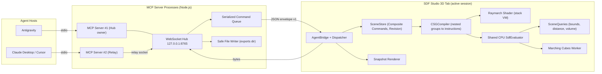
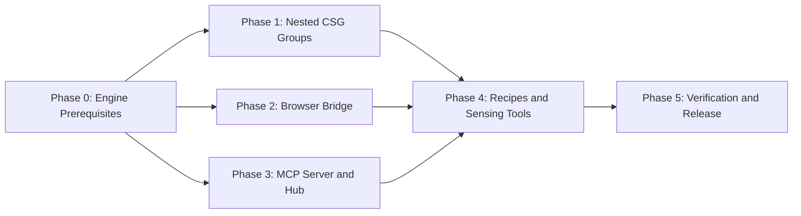

# SDF Studio 3D: MCP Server, Live Agent Bridge & Nested CSG Groups

> **Target:** Milestone 10 — Model Context Protocol (MCP) Server, Live WebSocket Bridge & Nested CSG Groups  
> **Audience:** External AI agents (Antigravity, Claude Desktop, Cursor), automations & scripts  
> **Status:** Revised plan (v2) — incorporates gap review of v1  
> **Revision Date:** 2026-11-09

---

## 🎯 Executive Summary

This milestone gives external AI agents **hands, eyes and a ruler** inside the *running* SDF Studio 3D browser viewport via the **Model Context Protocol (MCP)**:

- **Hands** — atomic edit tools plus one-shot declarative **scene recipes**, built on a new **nested CSG group** model so agents (and humans) can express `(A − B) ∪ (C − D)`.
- **Eyes** — clean, gizmo-free snapshots and multi-view contact sheets returned as native MCP image content.
- **Ruler** — numeric sensing: world bounds, SDF distance sampling and volume estimates, so agents can verify fit, gaps and containment without guessing from pixels.
- **Delivery** — `.glb` / `.obj` meshes, `.glsl` shaders and `.sdf.json` projects written safely to disk by the MCP server.

Every agent edit is a single undoable command, so the human can always <kbd>Ctrl+Z</kbd> the AI.

### Decisions Log

| # | Decision | Source |
| :- | :--- | :--- |
| D1 | Transport: **MCP over stdio** → local WebSocket hub → browser | User (Q1: A) |
| D2 | Execution context: **live in the browser** (no headless mode this milestone) | User (Q2) |
| D3 | Tool granularity: **atomic commands + declarative recipes** | User (Q3) |
| D4 | Sensing: **snapshots + bounds + distance/volume queries** | User (Q4: all) |
| D5 | **Nested CSG groups are in scope** for this milestone | User (review follow-up) |
| D6 | API rotations in **degrees**; internal storage stays radians | Review item 6 |
| D7 | One tool call / recipe = **one undo step** | Review item 8 |

---

## 🧭 Architecture



### Workspace Layout (npm workspaces)

```text
sdf-editor/
├── src/                          # Browser app (existing)
│   ├── bridge/                   # NEW: AgentBridge, BridgeDispatcher, HUD status pill
│   ├── engine/csg/               # NEW: CSGCompiler (tree -> instruction list)
│   ├── engine/cpu/               # NEW: SdfEvaluator (single CPU evaluator, replaces 3 copies)
│   └── engine/SceneQueries.ts    # NEW: bounds, distance sampling, volume
├── shared/protocol/              # NEW: Zod schemas, envelope types, error codes, primitive registry
├── mcp-server/                   # NEW: MCP server, hub/relay, tools, resources, prompts, file writer
└── e2e/                          # NEW: Playwright + scripted MCP client smoke tests
```

> [!IMPORTANT]
> `shared/protocol/` is the **single source of truth** for request/response schemas and the primitive dimension registry. Both the browser bridge and the MCP server import it, so types can never drift from [`types.ts`](file:///f:/Programming%20Projects/sdf-editor/src/tree/types.ts).

---

## 🧩 Nested CSG Groups (Engine Upgrade)

### Problem
Today [`flattenWithTransforms()`](file:///f:/Programming%20Projects/sdf-editor/src/tree/CSGTree.ts) flattens the tree and every evaluator (GPU shader, marching-cubes worker, `ScenePicker`, `ShaderExporter`) performs an **ordered left-fold**. Children inherit transforms only — they never form sub-expressions.

### New Semantics (Scene Document v2)

| Concept | Rule |
| :--- | :--- |
| **Group node** | New `type: 'group'`. Owns ordered children; has transform, name, CSG op/blend (applied against its preceding sibling), and post-distance modifiers (round, shell). |
| **Leaf node** | All 21 primitives. Leaves have **no children** in v2. |
| **Scope** | Children of a group fold left-to-right *inside* the group. The first child's operation is ignored (it initializes the group). The group result then combines with its predecessor using the group's own operation. |
| **Root** | Implicit top-level group. |
| **Transforms** | Hierarchical, unchanged (world matrices inherit through groups). |
| **Group modifiers** | Round & shell only. Domain modifiers on groups (array, symmetry, twist, bend) are **deferred to M11** — they require per-group domain warps in the VM. |

### Compilation: Tree → Postfix Instructions
A shared `CSGCompiler` emits a postfix program consumed by every evaluator:

```text
emit(group G = [c1, c2, ..., cn]):
    emit(c1)
    for i in 2..n:
        emit(ci)
        COMBINE(ci.op, ci.blendMode, ci.blendRadius)
    if G.round or G.shell: POST(G.round, G.shell)

emit(leaf L): PUSH_LEAF(L.gpuIndex)
```

Example `(A − B) ∪ (C − D)`: `PUSH A, PUSH B, COMBINE diff, PUSH C, PUSH D, COMBINE diff, COMBINE union`

### GPU Stack VM (`raymarch.frag.glsl`)
- New uniforms: `uInstr[MAX_INSTR]` (`vec4`: opcode, operand/op, blendMode, k), `uInstrCount`.
- Fixed-size distance stack (`MAX_STACK = 8`) plus a parallel material stack (`vec4 colorRoughness`, `float metalness`, `int nodeIndex`) so smooth unions still blend materials.
- Leaves of any group are **contiguous** in emission order → group selection highlight becomes a uniform index range `uSelectedRange = ivec2(start, end)`.

### CPU Parity
- New `src/engine/cpu/SdfEvaluator.ts` executes the same instruction list and **replaces the three duplicated CPU evaluators** in the worker, [`ScenePicker.ts`](file:///f:/Programming%20Projects/sdf-editor/src/engine/ScenePicker.ts) and the new `SceneQueries`.
- [`ShaderExporter.ts`](file:///f:/Programming%20Projects/sdf-editor/src/engine/ShaderExporter.ts) emits nested GLSL expressions recursively (no VM needed in exported code).

### Migration v1 → v2
- `SDFSceneDocument` gains `version: 2`.
- v1 loader **hoists children of primitive nodes** into following siblings in DFS pre-order, baking transforms to parent-relative locals. Because v1 already folds in DFS pre-order, rendering is **identical**.
- Applies to `.sdf.json` files and `localStorage` autosaves.
- Verified by an equivalence test: CPU distances at 1,000 random points must match before and after migration (ε = 1e-5).

### Studio UI for Groups
- **Outliner:** group glyph, expand/collapse, `+ Group`, **Ctrl+G** (wrap selected node in a new group), **Ctrl+Shift+G** (ungroup), drag-to-reparent, ↑/↓ reorder buttons (order now matters visibly).
- **Inspector (group):** name, transform, CSG op/blend, round/shell, child count.
- **Viewport:** click selects the leaf; **Alt+Click** selects its parent group; group selection highlights all descendants.
- **Shape Palette:** "Empty Group" card with bespoke icon.
- *Multi-select is out of scope (M11).*

---

## 🧰 MCP Surface

### Tools (19)

| # | Tool | Kind | Purpose | Key Inputs |
| :- | :--- | :--- | :--- | :--- |
| 1 | `sdf_get_scene` | Read | Tree, node IDs, ops, transforms, limits usage, selection, `revision` | `includeDimensions?` |
| 2 | `sdf_list_primitives` | Read | Primitive catalog with per-field descriptions, units, defaults, ranges | — |
| 3 | `sdf_add_primitive` | Edit | Add a leaf under a group at an index | `type`, `dimensions`, `position`, `rotationDeg`, `scale`, `operation`, `blend`, `material`, `modifiers`, `parentId?`, `index?` |
| 4 | `sdf_create_group` | Edit | Create an empty group, or wrap existing nodes | `name`, `parentId?`, `index?`, `wrapNodeIds?`, `operation`, `blend` |
| 5 | `sdf_update_node` | Edit | Patch any node fields | `nodeId`, partial fields |
| 6 | `sdf_delete_node` | Edit | Remove a node (and its subtree) | `nodeId` |
| 7 | `sdf_duplicate_node` | Edit | Clone a node/subtree with optional offset | `nodeId`, `offset?` |
| 8 | `sdf_move_node` | Edit | Reparent and/or reorder (order affects CSG) | `nodeId`, `newParentId?`, `index` |
| 9 | `sdf_ungroup` | Edit | Dissolve a group, preserving world transforms | `groupId` |
| 10 | `sdf_clear_scene` | Edit | Empty scene or reset to default | `mode: 'empty' \| 'default'` |
| 11 | `sdf_apply_scene_recipe` | Edit | Build/replace a full nested scene atomically | `recipe` (see spec), `mode`, `dryRun?` |
| 12 | `sdf_history` | Edit | Undo / redo | `action: 'undo' \| 'redo'`, `steps?` |
| 13 | `sdf_select_node` | UI | Select/deselect to direct the human's attention | `nodeId \| null` |
| 14 | `sdf_set_camera` | UI | Set viewport camera | `view` preset or `azimuthDeg`, `elevationDeg`, `distance`, `target` |
| 15 | `sdf_take_snapshot` | Sense | Clean render(s); single view or 2×2 contact sheet | `views[]`, `width`, `height`, `format`, `showGrid?`, `highlightNodeId?` |
| 16 | `sdf_get_bounds` | Sense | World AABB (scene/node), optional volume estimate | `nodeId?`, `tight?`, `includeVolume?` |
| 17 | `sdf_sample_distance` | Sense | Signed distance + nearest node at points (≤256) | `points[]`, `nodeId?` |
| 18 | `sdf_project` | File | Save/load `.sdf.json` | `action`, `filename` |
| 19 | `sdf_export` | File | Export mesh or shader | `format: 'glb' \| 'obj' \| 'glsl'`, `resolution`, `filename`, `overwrite?` |

All mutating tools accept optional `expectedRevision` and return `{ revision, ... }`.

### Resources

| URI | Content |
| :--- | :--- |
| `sdf://scene` | Current scene JSON; emits `resources/updated` on revision change |
| `sdf://primitives` | Primitive registry (same data as tool 2) |
| `sdf://conventions` | Axes, units, rotation order, floor height, limits, CSG semantics |
| `sdf://recipes/examples` | Annotated example recipes (mug, flanged pipe, sci-fi crate) |

### Prompts

| Prompt | Purpose |
| :--- | :--- |
| `model_object` | Args: `description`, `style?`. Guides the loop **plan → recipe → snapshot (4 views) → measure → refine**. |
| `refine_model` | Args: `feedback`. Critique current scene against feedback and apply minimal edits. |

---

## 📐 Conventions & Limits (published in `sdf://conventions`)

| Item | Value |
| :--- | :--- |
| Axes | Right-handed, **Y-up** |
| Units | Studio units (1.0 = one major grid cell) |
| Floor | Visual plane at **y = −1.2** (not geometry; not exported) |
| Rotation | API: **degrees**, Euler order XYZ. Storage: radians |
| Color / PBR | Hex `#rrggbb`; roughness & metalness in [0, 1] |
| Dimensions | Per-primitive canonical schema from `PRIMITIVE_SCHEMAS` (each field documents full vs half extents) |
| Max leaf primitives | **32** (GPU) — exceeding returns `LIMIT_EXCEEDED` (no more silent truncation) |
| Max instructions | 64 |
| Max nesting depth | 7 |
| Snapshot | ≤ 1024×1024 per view; default 512×512 |
| Mesh resolution | 32³ / 64³ / 128³; bounds auto-fit from `sdf_get_bounds` + 10% margin |
| Node names | ≤ 64 chars, control chars stripped |

---

## 🔌 Bridge Protocol (envelope v1)

```json
{ "v": 1, "type": "hello", "role": "studio", "protocol": 1, "token": "…", "appVersion": "1.10.0", "capabilities": ["groups", "snapshot", "queries"] }
{ "v": 1, "type": "welcome", "sessionId": "s_91c", "active": true }

{ "v": 1, "type": "request",  "id": "r42", "method": "scene.addPrimitive", "params": { }, "expectedRevision": 17 }
{ "v": 1, "type": "progress", "id": "r42", "progress": 0.4, "message": "Marching cubes 40%" }
{ "v": 1, "type": "response", "id": "r42", "ok": true,  "result": { }, "revision": 18 }
{ "v": 1, "type": "response", "id": "r42", "ok": false, "error": { "code": "LIMIT_EXCEEDED", "message": "Scene has 32/32 primitives.", "hint": "Delete or merge nodes, or use a radial/linear array modifier." } }
```

| Concern | Behavior |
| :--- | :--- |
| **Timeouts** | Default 10 s · snapshot 15 s · export 120 s (with MCP progress notifications) |
| **Heartbeat** | Ping every 5 s; connection considered dead after 15 s |
| **Serialization** | Hub queues mutating requests FIFO; reads may run concurrently |
| **Concurrency with human** | `revision` increments on every execute/undo/redo; stale `expectedRevision` → `REVISION_CONFLICT` with scene summary |
| **Error codes** | `VALIDATION_ERROR`, `NODE_NOT_FOUND`, `LIMIT_EXCEEDED`, `REVISION_CONFLICT`, `STUDIO_NOT_CONNECTED`, `SESSION_PARKED`, `TIMEOUT`, `EXPORT_FAILED`, `PATH_REJECTED`, `UNSUPPORTED_PROTOCOL` |
| **MCP results** | Errors returned as `isError: true` with actionable text; internals logged to stderr only |

---

## 🧾 Scene Recipe Spec

```json
{
  "mode": "replace",
  "dryRun": false,
  "nodes": [
    {
      "ref": "shell", "type": "group", "name": "Mug Shell",
      "children": [
        { "ref": "outer",  "type": "cylinder", "dimensions": { "radius": 0.6, "height": 1.4 }, "material": { "color": "#d9c7a7", "roughness": 0.4 } },
        { "ref": "cavity", "type": "cylinder", "operation": "difference", "position": [0, 0.1, 0], "dimensions": { "radius": 0.5, "height": 1.4 } }
      ]
    },
    {
      "ref": "handle", "type": "torus", "operation": "union",
      "blend": { "mode": "smooth", "radius": 0.05 },
      "position": [0.75, 0, 0], "rotationDeg": [90, 0, 0],
      "dimensions": { "radiusMajor": 0.3, "radiusMinor": 0.07 }
    }
  ]
}
```

- `mode`: `replace` (clear then build) or `append` (insert under `parentId` at `index`).
- **Atomic:** the whole recipe is validated first (schema, limits, depth, refs). Nothing is applied on failure.
- `dryRun: true` → returns validation report + predicted bounds + leaf/instruction counts without mutating.
- Response: `{ revision, refs: { "shell": "node_ab12", ... }, counts: { leaves, instructions, depth }, warnings: [] }`.
- One recipe = **one** `CompositeCommand` = one undo step.

---

## 🔒 Security & Sessions

| Threat / Concern | Mitigation |
| :--- | :--- |
| Any local web page or process connecting to the hub | Bind **127.0.0.1** only; **Origin allowlist** (`http://localhost:5173`, `http://127.0.0.1:5173`, served-app origin); **pairing token** required in `hello` |
| Token delivery to the browser | When the MCP server opens the studio it appends `#bridge=<token>`. If the user opened it manually, `STUDIO_NOT_CONNECTED` returns a 6-digit pairing code for the agent to relay; the user enters it in the HUD |
| Relay authentication | Hub writes `{ port, token }` to `%LOCALAPPDATA%/sdf-studio/bridge.json` (user-only permissions); relays read it |
| Unwanted control | Bridge is **opt-in**: HUD toggle `Agent Bridge: Off / Listening / Connected`, persisted per browser |
| Multiple MCP hosts (port collision) | First process binds and becomes **Hub**; later processes get `EADDRINUSE` and connect as **Relays**; if the hub exits, a relay re-binds and promotes itself. Port override via `SDF_BRIDGE_PORT` |
| Multiple studio tabs | Last `hello` wins the **active session**; other tabs are **parked** (HUD: "Controlled in another tab — Take control") |
| Arbitrary file writes | MCP server writes only inside `SDF_EXPORT_DIR` (default `<repo>/exports`); rejects absolute paths and `..`; whitelisted extensions; no overwrite unless `overwrite: true` |
| Prompt injection via scene content | Node names sanitized and length-capped before being returned to agents |
| Corrupting the stdio protocol | No `console.log` in the MCP server; all logs go to **stderr** |
| Mixed content when hosted over HTTPS | Supported in Chromium/Firefox for `ws://localhost`; Safari unsupported (documented) |

### App Hosting & Auto-Launch
- If `SDF_STUDIO_URL` is set (e.g. Vite dev at `http://localhost:5173`), use it.
- Otherwise the MCP server serves the built `dist/` on `http://127.0.0.1:5174`.
- Auto-open the browser on first tool call when no studio is connected (`SDF_AUTO_OPEN=1`, default on).

---

## 📋 Phased Implementation Plan



Phases 1, 2 and 3 run **in parallel** once Phase 0's shared schemas land.

### Phase 0 — Engine Prerequisites
| ID | Task | Owner | Done When |
| :- | :--- | :--- | :--- |
| 0.1 | `CompositeCommand` + `store.transaction(name, fn)` | `game-developer` | N mutations = 1 undo step; unit tested |
| 0.2 | Scene `revision` counter on execute/undo/redo | `game-developer` | Revision increments monotonically; tested |
| 0.3 | `SceneLimits` validator; UI toast instead of silent truncation | `game-developer` | Adding the 33rd leaf errors in API and warns in UI |
| 0.4 | `PRIMITIVE_SCHEMAS` registry in `shared/protocol/` (defaults, ranges, descriptions, internal mapping) | `game-developer` | Registry covers all 21 primitives; palette defaults read from it |
| 0.5 | Shared `SdfEvaluator` (CPU) replacing worker/picker duplicates | `game-developer` | Worker + picker tests pass on shared evaluator |
| 0.6 | `SceneQueries`: bounds (analytic + tight sampled), distance sampling, volume estimate | `game-developer` | Sphere/box bounds & volume within 2% of analytic |
| 0.7 | `renderer.renderSnapshot(opts) → { dataUrl, camera }` (resize, hide gizmo + highlight, restore camera/size) | `frontend-developer` | Returns PNG/JPEG/WebP; user view unchanged afterwards |
| 0.8 | Mesh export returns `ArrayBuffer`; auto-fit bounds from `SceneQueries` | `game-developer` | No clipping beyond ±2.2; UI download unchanged |
| 0.9 | `shared/protocol/` package: Zod envelope, method schemas, error codes; npm workspaces | `backend-developer` | App and server both import it; typecheck green |

### Phase 1 — Nested CSG Groups
| ID | Task | Owner | Done When |
| :- | :--- | :--- | :--- |
| 1.1 | `group` node type, v2 document, v1→v2 migration + equivalence test | `game-developer` | Migrated scenes render identically (ε = 1e-5) |
| 1.2 | `CSGCompiler` (postfix instructions, limits, depth) | `game-developer` | `(A−B)∪(C−D)` compiles to expected program |
| 1.3 | GPU stack VM + material stack + `uSelectedRange` | `game-developer` | Visual parity on existing scenes; FPS regression ≤ 10% at 32 leaves |
| 1.4 | CPU evaluator, picker & worker on instruction list; recursive `ShaderExporter` | `game-developer` | CPU/GPU parity tests; exported GLSL compiles |
| 1.5 | Outliner group UX (Ctrl+G, Ctrl+Shift+G, drag reparent, reorder) & group Inspector | `frontend-developer` | All actions undoable; tests for store ops |
| 1.6 | Group icon, Outliner hierarchy styling, "Empty Group" palette card | `creative-director` | Vibe Check passed |

### Phase 2 — Browser Bridge
| ID | Task | Owner | Done When |
| :- | :--- | :--- | :--- |
| 2.1 | `AgentBridge` (connect, hello/welcome, heartbeat, reconnect backoff) | `frontend-developer` | Survives hub restart; parks correctly with 2 tabs |
| 2.2 | `BridgeDispatcher` mapping methods → store/renderer/queries via transactions | `frontend-developer` | Every mutating method = 1 undo step |
| 2.3 | HUD pill: Off / Listening / Connected / Parked + pairing code entry | `frontend-developer` + `creative-director` | Opt-in persisted; Vibe Check passed |

### Phase 3 — MCP Server & Hub
| ID | Task | Owner | Done When |
| :- | :--- | :--- | :--- |
| 3.1 | Scaffold `mcp-server/` (`@modelcontextprotocol/sdk` pinned, `ws`, `zod`), stdio transport, stderr logger | `backend-developer` | `initialize` handshake works from a test client |
| 3.2 | Hub/relay with promotion, Origin check, token, FIFO mutation queue, timeouts | `backend-developer` | Two MCP processes share one studio; hub failover tested |
| 3.3 | Register 19 tools, 4 resources, 2 prompts | `backend-developer` | Contract tests validate every schema |
| 3.4 | Safe file writer (`SDF_EXPORT_DIR`, extension allowlist, no traversal) | `backend-developer` | Traversal and absolute-path attempts rejected |
| 3.5 | Static `dist/` server + auto-launch with `#bridge=<token>` | `backend-developer` | Tool call with no studio opens and pairs a tab |
| 3.6 | Security review of hub, pairing, file writer | `security-auditor` | No high/critical findings open |

### Phase 4 — Recipes & Sensing Tools
| ID | Task | Owner | Done When |
| :- | :--- | :--- | :--- |
| 4.1 | Recipe validator, `ref` resolution, `dryRun`, replace/append | `backend-developer` + `game-developer` | Invalid recipe changes nothing; refs map returned |
| 4.2 | Snapshot & contact sheet tools (image content, size caps) | `frontend-developer` | 2×2 sheet ≤ 1024² returned in one call |
| 4.3 | Bounds, distance, volume tools | `game-developer` | Matches `SceneQueries` unit results |
| 4.4 | Example recipes resource + `model_object` / `refine_model` prompts | `backend-developer` | Examples load and render correctly |

### Phase 5 — Verification & Release
| ID | Task | Owner | Done When |
| :- | :--- | :--- | :--- |
| 5.1 | Unit tests: compiler, VM parity (CPU), migration, composite commands, queries | `test-engineer` | All green; coverage on new modules ≥ 80% |
| 5.2 | Contract tests: every tool schema & error code via scripted MCP client | `test-engineer` | All tools exercised, including failure paths |
| 5.3 | E2E: Playwright (Chromium + SwiftShader) + MCP client builds mug recipe, snapshots, exports GLB | `qa-engineer` | Repeatable in CI; GLB validates |
| 5.4 | Client configs (Antigravity `mcp_config.json`, Claude Desktop, Cursor) + README section | `backend-developer` | Copy-paste configs verified on Windows |
| 5.5 | Final gate: `npm test`, `npm run typecheck`, `npm run build` (app + server) | `project-manager` | All pass; TODO.md synced; Conventional Commit |

---

## ✅ Milestone Acceptance Criteria

1. An agent can build `(A − B) ∪ (C − D)` via nested groups using either atomic tools or one recipe.
2. A recipe of up to 32 leaves applies atomically and is undone with a single <kbd>Ctrl+Z</kbd>.
3. `sdf_take_snapshot` returns a clean 2×2 contact sheet without moving the user's camera.
4. `sdf_get_bounds` and `sdf_sample_distance` match analytic values for reference shapes.
5. `sdf_export` writes a valid `.glb` inside `SDF_EXPORT_DIR` with no clipping.
6. Two agent hosts can run simultaneously without port errors; two tabs resolve to one active session.
7. Existing v1 projects load and render identically.
8. No high or critical findings in the security review; full test/typecheck/build gate passes.

---

## ⚠️ Risks & Mitigations

| Risk | Mitigation |
| :--- | :--- |
| Dynamic array indexing for the GPU stack | Three.js targets WebGL2 / GLSL ES 3.00, which permits it; fallback: unrolled fixed-depth stack via `if (sp == n)` chains |
| Shader performance regression from the VM loop | Benchmark before/after at 8/16/32 leaves; budget ≤ 10% FPS loss |
| Snapshot token cost for agents | Default 512² JPEG/WebP; contact sheet replaces four calls |
| Background-tab throttling | Snapshots render synchronously on request; generous timeouts; heartbeat surfaces dead tabs |
| MCP SDK API changes | Pin exact SDK version; contract tests catch breaks |
| Hub failover edge cases | Relay promotion covered by integration tests (kill hub mid-session) |

---

## 🔭 Deferred to Milestone 11

- Domain modifiers on groups (array, symmetry, twist, bend applied to whole groups)
- Multi-select in the Outliner/Viewport
- Headless (no-browser) execution mode
- High-level parametric generators (gears, flanges, brackets) as tools
