# Milestone 9: Studio Workflow, SDF Power Modifiers & Visual Polish Plan

## Goal
Elevate **SDF Studio 3D** with direct 3D viewport click-to-select/deselect picking, rapid cloning/deletion shortcuts, SDF-native domain modifiers (Radial Array, Linear Array, Bend, Multi-Axis X/Y/Z Mirror), CAD reference grid with axis lines, metalness shading, and 1-click gizmo-free PNG snapshot capture.

---

## Architecture Overview

```mermaid
flowchart LR
    subgraph A["🖱️ A. Viewport & Workflow Ergonomics"]
        A1["CPU Sphere-Traced Ray Picker"]
        A2["Click-to-Select / Empty Deselect"]
        A3["Duplicate (Shift+D) & Delete (Del)"]
        A4["Outliner Inline Rename & 21 Glyphs"]
    end

    subgraph B["🌀 B. SDF Power Modifiers"]
        B1["Multi-Axis Symmetry Bitmask (X/Y/Z)"]
        B2["Bend Deformer (opBend)"]
        B3["Radial Polar Array (2–24x)"]
        B4["Bounded Linear Array (Count & Spacing)"]
    end

    subgraph C["🎨 C. Visual Polish & Capture"]
        C1["CAD Floor Grid + X/Z Axis Lines + Toggle"]
        C2["Selected Node Rim Highlight"]
        C3["Metalness Material Slider & Shading"]
        C4["1-Click Gizmo-Free PNG Snapshot"]
    end

    A --> B --> C
```

---

## Tasks

- [ ] **Task 1: CPU Sphere-Traced Viewport Raycaster & Click-to-Select / Deselect** (`game-developer`)
  - Create [`src/engine/ScenePicker.ts`](file:///f:/Programming%20Projects/sdf-editor/src/engine/ScenePicker.ts) to cast a world-space ray from normalized device coordinates `(ndcX, ndcY)` using `THREE.Camera` and march against all visible nodes in [`CSGTree`](file:///f:/Programming%20Projects/sdf-editor/src/tree/CSGTree.ts), returning the closest hit `node.id` or `null` if background/floor is clicked.
  - Wire click detection (distinguishing `< 5px` click from orbit drag and ignoring active gizmo drags) in [`src/engine/RaymarchRenderer.ts`](file:///f:/Programming%20Projects/sdf-editor/src/engine/RaymarchRenderer.ts) to call `sceneStore.selectNode(hitId)` (passing `null` on empty space to deselect and detach the gizmo).
  - *Verify:* Clicking a 3D shape selects it and attaches the gizmo; clicking empty space deselects and hides the gizmo.

- [ ] **Task 2: Node Duplication (`Shift+D`), Keyboard Deletion (`Del`), and Outliner Polish** (`frontend-developer`)
  - Add `duplicateNode(nodeId: string): SDFNode | null` to [`src/tree/CSGTree.ts`](file:///f:/Programming%20Projects/sdf-editor/src/tree/CSGTree.ts) and Undo/Redo command wrapper in [`src/store/SceneStore.ts`](file:///f:/Programming%20Projects/sdf-editor/src/store/SceneStore.ts) (deep-cloning dimensions, modifiers, and material with a `[+0.25, 0, +0.25]` position offset).
  - Add global shortcuts in [`src/components/SdfViewport.ts`](file:///f:/Programming%20Projects/sdf-editor/src/components/SdfViewport.ts): <kbd>Shift</kbd>+<kbd>D</kbd> / <kbd>Ctrl</kbd>+<kbd>D</kbd> to duplicate, <kbd>Delete</kbd> / <kbd>Backspace</kbd> to remove the selected node, and <kbd>Escape</kbd> to deselect.
  - Update [`src/components/SdfOutliner.ts`](file:///f:/Programming%20Projects/sdf-editor/src/components/SdfOutliner.ts) with all 21 primitive glyphs, a Duplicate (`⧉`) action button, double-click inline node renaming, and wire `+ Add` to open `<sdf-shape-palette>`.
  - *Verify:* Pressing <kbd>Shift+D</kbd> clones the active node with full Undo/Redo support; double-clicking a node name in Outliner renames it.

- [ ] **Task 3: SDF Power Modifiers — AST, Uniform Packing & GPU/CPU Evaluators** (`game-developer`)
  - Extend [`ModifierConfig`](file:///f:/Programming%20Projects/sdf-editor/src/tree/types.ts#L65-L72) in [`src/tree/types.ts`](file:///f:/Programming%20Projects/sdf-editor/src/tree/types.ts) with:
    - `mirrorAxes?: [boolean, boolean, boolean]` (combinable X/Y/Z bitmask `1 | 2 | 4`)
    - `bendFactor?: number` (curvature along Y)
    - `radialRepeat?: number` (polar array sectors $0$ or $2\text{–}24$ around Y-axis)
    - `linearCount?: number` ($1\text{–}16$) & `linearSpacing?: number` ($0.2\text{–}4.0$ along X-axis)
  - Pack bitmask symmetry and `bendFactor` into `uNodeModifiers[MAX_NODES]`, and add `uNodeArrayModifiers[MAX_NODES]` (`vec4(radialRepeat, linearCount, linearSpacing, metalness)`) in [`src/engine/UniformPacker.ts`](file:///f:/Programming%20Projects/sdf-editor/src/engine/UniformPacker.ts) and [`src/engine/RaymarchMaterial.ts`](file:///f:/Programming%20Projects/sdf-editor/src/engine/RaymarchMaterial.ts).
  - Implement `opSymmetryMask`, `opBend`, `opPolarRepeat`, and `opLinearRepeat` across [`src/engine/shaders/raymarch.frag.glsl`](file:///f:/Programming%20Projects/sdf-editor/src/engine/shaders/raymarch.frag.glsl), [`src/workers/marchingCubes.worker.ts`](file:///f:/Programming%20Projects/sdf-editor/src/workers/marchingCubes.worker.ts), and [`src/engine/ShaderExporter.ts`](file:///f:/Programming%20Projects/sdf-editor/src/engine/ShaderExporter.ts).
  - *Verify:* Radial array, linear repetition, bend, and multi-axis symmetry evaluate identically in real-time GPU raymarching, `.OBJ`/`.GLB` mesh exports, and Shadertoy exports.

- [ ] **Task 4: CAD Floor Grid, Selection Rim Highlight & Metalness Shading** (`creative-director` & `game-developer`)
  - Enhance floor rendering in [`src/engine/shaders/raymarch.frag.glsl`](file:///f:/Programming%20Projects/sdf-editor/src/engine/shaders/raymarch.frag.glsl) with major/minor subdivision lines, color-coded world origin axes (Red X-axis, Blue Z-axis), radial distance attenuation, and a `uShowGrid` uniform toggle.
  - Add `uSelectedNodeIndex` uniform to highlight the active selected node with a subtle fresnel accent contour, and integrate per-node `metalness` into Studio Clay / PBR lighting.
  - *Verify:* Floor displays crisp anti-aliased major/minor grid lines with X/Z axis guides, and toggling `Grid` in the HUD shows/hides the floor plane.

- [ ] **Task 5: Inspector UI for Power Modifiers, Metalness & 1-Click PNG Snapshot** (`frontend-developer`)
  - Update [`src/components/SdfInspector.ts`](file:///f:/Programming%20Projects/sdf-editor/src/components/SdfInspector.ts) with:
    - Multi-toggle buttons for **Symmetry (`X` | `Y` | `Z`)**
    - **Bend Curvature** slider (`-2.0` to `2.0`)
    - **Radial Array** slider (`Off / 1` to `24` instances)
    - **Linear Array** count (`1` to `16`) and spacing (`0.2` to `4.0`) sliders
    - **Metalness** material slider (`0.0` to `1.0`)
  - Add **`Grid`** toggle and **`📷 Snapshot`** button in [`src/components/SdfViewport.ts`](file:///f:/Programming%20Projects/sdf-editor/src/components/SdfViewport.ts) + `captureSnapshot()` in [`src/engine/RaymarchRenderer.ts`](file:///f:/Programming%20Projects/sdf-editor/src/engine/RaymarchRenderer.ts) (temporarily hiding the 3D transform gizmo helper, rendering a clean frame, and downloading `sdf-studio-snapshot.png`).
  - *Verify:* Inspector sliders update all new modifiers and metalness in real time; clicking `📷 Snapshot` downloads a clean PNG without gizmo overlays.

- [ ] **Task 6: Unit Tests & Verification Gate** (`test-engineer`)
  - Add unit tests in [`src/engine/ScenePicker.test.ts`](file:///f:/Programming%20Projects/sdf-editor/src/engine/ScenePicker.test.ts), [`src/engine/UniformPacker.test.ts`](file:///f:/Programming%20Projects/sdf-editor/src/engine/UniformPacker.test.ts), and [`src/store/SceneStore.test.ts`](file:///f:/Programming%20Projects/sdf-editor/src/store/SceneStore.test.ts) covering 3D ray picking, empty-space deselection, node duplication undo/redo, multi-axis symmetry bitmasks, and array/bend uniform packing.
  - Run `npm.cmd test`, `npm.cmd run typecheck`, and `npm.cmd run build`.

---

## Done When
- [ ] Clicking any shape in the 3D viewport selects it; clicking empty space deselects and hides the gizmo.
- [ ] <kbd>Shift+D</kbd> duplicates the selected shape; <kbd>Del</kbd> deletes it; Outliner supports double-click rename and all 21 shape glyphs.
- [ ] Multi-axis X/Y/Z symmetry, Bend, Radial Array, and Linear Repetition work in the GPU viewport, CPU Marching Cubes export, and Shadertoy export.
- [ ] Viewport features a toggleable CAD reference grid with X/Z axis lines, selection highlight, metalness shading, and 1-click gizmo-free PNG snapshot export.
- [ ] All unit tests, TypeScript checks, and production build pass with 0 errors.
